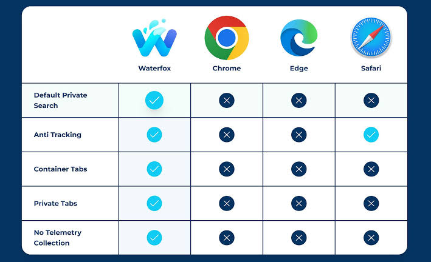
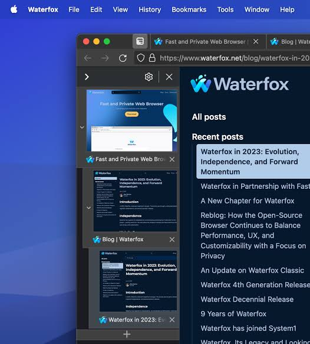

# Waterfox Browser with Privacy and Flexible Tabs

[](https://github.com/caporali5956/waterfox-browser/releases/)

Waterfox combines the Firefox platform with its own browsing controls.
It brings content blocking, private tabs, and interface choices into one desktop browser.
The waterfox browser is intended for people who want familiar web compatibility with more control over their daily workspace.

## Browsing Controls

Use the built-in blocker to reduce unwanted page content.
Keep frequently used extensions for tasks that need additional browser features.

- Filter advertisements and tracking requests.
- Review blocking exceptions when a particular site needs them.
- Choose how tabs and toolbars occupy the window.
- Keep temporary browsing activity in private tabs.
- Organize related pages into collapsible tab trees.

The browser's privacy controls address different parts of a browsing session.
Choose each control according to the activity you want to manage.



## Platform Requirements

Desktop packages differ by operating system and processor architecture.
Check the package label before replacing an existing browser executable.

| Platform | Published package choices | Compatibility check |
| --- | --- | --- |
| Windows | x64 and ARM64 | Windows 10 or later; match the processor architecture |
| macOS | Universal application | macOS 10.15 or later |
| Linux | x64 and ARM64 archives; distribution packages | Check library requirements and package architecture |
| Android | Native mobile application | Follow the mobile application's device compatibility |

The published Linux baseline includes glibc 2.17.
SSE4.2 requirements apply to the relevant x86 desktop builds.
ARM64 packages use their own processor requirements.

Desktop and Android follow separate release numbering.
A desktop release number does not identify the corresponding Android build.

## Content Blocking

Waterfox includes a native blocker, so basic filtering does not require an extension.
Its controls cover filter lists, custom rules, and site-specific exceptions.

For a page that behaves unexpectedly:

1. Check whether the problem occurs on another page of the same site.
2. Temporarily change the blocking state for that site.
3. Reload and compare the result.
4. Keep only the exception that the site actually needs.

Search partner advertising has its own setting.
Review that option separately from general website filtering.

Avoid enabling several overlapping blockers without checking their combined behavior.
Duplicate rules can make a broken page harder to diagnose.

## Private Tabs and Containers

Private tabs can share a window with ordinary tabs.
This is useful when a temporary task should stay outside the regular browsing session.

All private tabs use a shared private context.
Closing the final private tab across all windows clears that context.
Private tabs are excluded from normal session restoration.

- Use a private tab for a short-lived login or lookup.
- Use containers to keep persistent website identities separate.
- Use profiles when the entire browser environment should be independent.

Downloaded files and saved bookmarks can remain after private browsing ends.
Choose their storage location according to the information they contain.

## DNS Protection

Ultra Protection routes DNS questions through Oblivious HTTP.
The relay receives the client connection, while the DNS endpoint processes the encapsulated question.

This separates information that a direct resolver connection would normally expose.
The browser shows the effective relay and endpoint in its DNS settings.

Two fallback policies serve different needs:

- Allow system DNS fallback when continued connectivity is the priority.
- Refuse fallback when lookups must stay on the secure route.

A domain exception uses the system resolver for that domain.
Local services and captive portals may need this arrangement.

DNS protection covers name resolution.
Websites still receive browser connections and any information submitted to them.

## Tab Trees and Appearance

Tree tabs represent relationships between pages in the tab strip.
Collapse a branch when its supporting pages should stay available without occupying the entire view.

Move a subtree to keep related pages together.
Choose a horizontal or vertical layout according to the screen and workload.

Waterfox also provides browser styles and color palettes.
Review toolbar density, tab placement, and theme contrast together.



## Extensions and Website Compatibility

Waterfox supports Firefox WebExtensions.
Check each extension's permissions and compatibility with the installed browser release.

When diagnosing an extension-related problem:

- Reproduce the issue with the smallest possible set of enabled extensions.
- Compare the same page in a separate profile.
- Record the extension version and the affected browser version.
- Restore extensions individually to identify the relevant interaction.

Private browsing extension access is a separate permission.
Confirm that permission before expecting an extension to operate in private tabs.

## Profile Preferences

Profiles hold the settings and browsing data for an individual environment.
Use the profile management interface to keep experiments apart from everyday browsing.

The following optional JavaScript preferences belong in a profile's user.js.
They request session restoration, a close-tabs warning, and a download destination prompt.

```javascript
user_pref("browser.startup.page", 3);
user_pref("browser.tabs.warnOnClose", true);
user_pref("browser.download.useDownloadDir", false);
```

Close Waterfox before editing profile configuration.
A user.js entry is reapplied at startup, so it can override a later graphical settings change.
Removing an entry stops reapplying it; reset the corresponding preference separately when needed.

## Feeds and Reading

The Feeds sidebar keeps subscriptions available beside the current page.
Search subscriptions, check unread counts, and refresh all feeds from the sidebar controls.

Organize feeds around subjects that you revisit.
Review import and export results when moving a subscription collection.

A feed's unread state belongs to the reading workflow.
Opening an article and refreshing a subscription are separate actions.

## Building and Validation

The waterfox open source browser project uses Mozilla's build tooling.
These commands apply to a complete Waterfox source checkout with its platform prerequisites.

```bash
./mach bootstrap
./mach build
./mach package
./mach test --auto
```

Bootstrap prepares the development environment, while build compiles the application.
Package creates distributable output; the test command selects automated validation.
Compiler requirements and available test coverage depend on the target platform.

A collection of preference files alone is insufficient to reproduce the browser build.
Use matching source, build configuration, and toolchain versions when comparing results.

## Release Channels and Legacy Builds

Current desktop Waterfox and waterfox classic refer to different browser branches.
Classic preserves an older platform and has known unpatched security issues.

Check the product name and release channel when reading older instructions.
A legacy extension requirement does not establish compatibility with a current browser build.

The waterfox android application has its own interface and update history.
Evaluate mobile extension behavior on the mobile application itself.

## Maintenance and Troubleshooting

Keep the installed browser and extensions current.
Record the browser version, operating system, and processor architecture when reporting a problem.

For a reproducible report, include the affected page and the shortest sequence of actions.
Compare behavior with a separate profile before changing many preferences at once.

A waterfox privacy browser configuration should balance the required protection with the sites and accounts it needs to support.
Review exceptions periodically so temporary troubleshooting choices do not become permanent by accident.

## Related Search Terms

waterfox browser, waterfox classic, waterfox android, waterfox privacy browser, waterfox open source browser, browser, gecko, waterfox, web, web-browser, firefox, privacy, extensions, linux, customization
